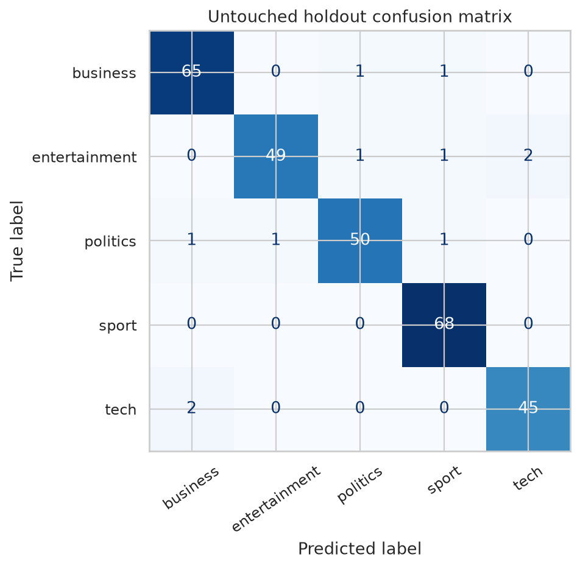

# NewsBot Intelligence System — ITAI 2373 Midterm

**José Miguel Tuozzo Izaguirre**

This is the course portfolio entry for **NewsBot Intelligence System**. The [main repository](https://github.com/jtuozzo1616/Mid-Term-Jose-Group-NewsBot-Intelligence-System) contains the maintained source, eight NLP modules, evaluation artifacts and research documentation.

**[Browse executed notebook with outputs](docs/NewsBot_Executed_Results.ipynb)** · **[Launch in Google Colab](https://colab.research.google.com/github/jtuozzo1616/Mid-Term-Jose-Group-NewsBot-Intelligence-System/blob/main/RUN_NEWSBOT_IN_COLAB.ipynb)** · **[Read the research results](https://github.com/jtuozzo1616/Mid-Term-Jose-Group-NewsBot-Intelligence-System/blob/main/docs/Technical_Results_Summary.md)** · **[View completed execution](https://github.com/jtuozzo1616/Mid-Term-Jose-Group-NewsBot-Intelligence-System/actions/runs/38775732890)**

## Project at a glance

NewsBot uses historical BBC articles to classify stories into business, entertainment, politics, sport and technology. Its eight modules cover data preparation, preprocessing, TF-IDF, POS tagging, syntax, sentiment, supervised classification and named entity recognition.

The recorded experiment retained **1,440 articles** after exact-text deduplication and reserved 288 for testing. The tuned Linear SVM achieved **96.18% holdout accuracy** (277 correct) and **0.9605 macro-F1**. These results describe one historical news dataset; they do not establish how the system would perform on today's reporting.

## Looking beyond the accuracy score

The [BBC holdout confusion matrix](outputs/06_confusion_matrix.png) shows **11 misclassified articles out of 288**. NewsBot missed four entertainment stories, while the sport desk received three articles from other categories—even though all 68 actual sport articles were recovered. The [error case study](docs/HOLDOUT_ERROR_CASE_STUDY.md) examines all nine observed confusion directions and proposes a human-review policy for mixed-topic articles.

## Where to find everything

| Deliverable | Link |
|---|---|
| Fully executed notebook | **[Open saved outputs, figures, and predictions](docs/NewsBot_Executed_Results.ipynb)** |
| Runnable notebook | [Midterm_NewsBot_Intelligence_System.ipynb](Midterm_NewsBot_Intelligence_System.ipynb) |
| Reproducible setup | [QUICK_START_EN.md](QUICK_START_EN.md) |
| Figures and evaluation | [outputs/](outputs/) |
| Technical report | [Current PDF — 7 pages](docs/MT_Report_Group_Solo_Jose_Miguel_Tuozzo_Izaguirre_ITAI2373.pdf) |
| Reflection | [Current PDF — 2 pages](docs/NewsBot_Reflection_Solo.pdf) · [Personal reading copy](docs/Personal_Reflection_Reading_Copy.md) |
| Evidence from a completed execution | [GitHub Actions run](https://github.com/jtuozzo1616/Mid-Term-Jose-Group-NewsBot-Intelligence-System/actions/runs/38775732890) |
| Professor's review guide | [Direct evidence and five-minute review path](docs/PROFESSOR_REVIEW_GUIDE.md) |
| Error diagnosis | [Detailed audit of all 11 incorrect predictions](docs/HOLDOUT_ERROR_CASE_STUDY.md) · [Count-only CSV](outputs/error_directions.csv) |

The portfolio now provides **both** a clean notebook for running from scratch and a permanently committed notebook containing actual execution outputs. Its report, reflection, and executed notebook are byte-for-byte identical to the versions in the main project.

For scope, source attribution, limitations and the optional Streamlit interface, see the [main README](https://github.com/jtuozzo1616/Mid-Term-Jose-Group-NewsBot-Intelligence-System). The professor's dataset-use approval and final submission arrangement should be confirmed separately.
