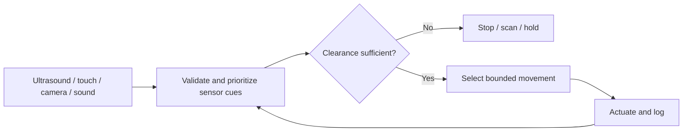

# PiDog Robotics — ITAI 2374

**José Miguel Tuozzo Izaguirre | Applied AI & Robotics | Fall 2026**

## Course artifacts

- [Lab 1 hardware diagnostic](lab01/Jose_Tuozzo_Lab1_PiDog_RaspberryPi.py) — recovered source with a missing Path import corrected; hardware only.
- [Buddy Autonomy and voice/vision archive](buddy/README.md) — actual recovered source and reproducible offline self-tests.
- [Historical terminal observations](evidence/TERMINAL_OBSERVATIONS.md) — selected anonymized log excerpts.
- [Course coverage and validation boundaries](COURSE_COVERAGE.md).

## Problem and approach

A quadruped robot must coordinate motion, sense its surroundings and respond to human input without treating unreliable sensor readings as safe clearance. This portfolio preserves two course implementations: a terminal-driven midterm controller and a reactive multi-sensor navigation lab.

| Artifact | Purpose |
|---|---|
| [pidog_midterm.py](pidog_midterm.py) | Basic motion, custom inspection sequence, distance/touch feedback, SSH menu |
| [lab10_multisensor.py](lab10_multisensor.py) | Range-prioritized obstacle avoidance, green-marker tracking, touch pause/resume, sound cues and CSV logging |
| [test_lab10_logic.py](test_lab10_logic.py) | Hardware-independent logic checks |



## Results and evidence scope

The November 2 midterm documentation records a completed custom inspection routine, authenticated SSH operation, and vendor patrol/response terminal readings including 10.02 cm (danger), 51.06 cm, 10.68 cm, 7.95 cm and touch states L, LS and RS. The report also discloses interrupted calibration, a camera initialization error and invalid -2 cm sensor readings. These are historical observations, not a fresh test of every recovered script.

The Lab 10 report records eight passing hardware-independent logic tests in its original build environment. The test file is included for independent reproduction. The integrated physical course outcomes, timing, collision rate and goal-success rate are not established by that report; no invented hardware metrics are included. This is reactive navigation, not SLAM, ROS 2 integration, or an autonomous safety guarantee.

## How to run

### Offline tests (no hardware; Python 3.10+)

```bash
cd ITAI2374-PiDog
python3 -m unittest -v test_lab10_logic.py
python3 -m py_compile pidog_midterm.py lab10_multisensor.py
```

The offline tests use only Python's standard library. All eight Lab 10 tests passed again in the portfolio review; Buddy's independent simulator and V9 range-filter self-tests also passed. Run `python verify_offline.py` to repeat the combined checks. They do not move a robot.

### Real hardware (supervised only)

Install PiDog and Vilib using the manufacturer instructions for your specific hardware and OS. Calibrate servos, confirm camera orientation and verify individual sensors first. Work on a level, clear floor, away from people, pets, stairs and edges. Keep physical power cutoff available; stop immediately on abnormal motion. Do not run motor scripts on a laptop or expose robot control to the public internet.

```bash
# From the repository folder on your configured Raspberry Pi:
sudo python3 pidog_midterm.py --mode read
# Only after confirming the setup and clearance:
sudo python3 pidog_midterm.py --mode custom
sudo python3 lab10_multisensor.py --arm --duration 10 --color green
```

Ctrl+C requests a stop. Test scan direction and camera mirroring before any obstacle-course trial. A 10-second pilot is the starting point, not a guarantee of safety.

## Data access and output

No external training dataset is needed. Input is live sensor readings from PiDog. Lab 10 writes a local CSV decision log (time, state, range, touch, sound, marker and command); record your own trials. No private network addresses, credentials, or claimed hardware logs are bundled.

## Learning and next steps

The course work demonstrated the importance of synchronized motion queues, sensor validity checks, priority-based decision logic and reproducible test cases. Next steps: capture repeatable physical trials, record calibration evidence, compare expected and observed behavior, and separately validate voice/LLM experiments before adding them to this portfolio.

## References

- [SunFounder PiDog documentation and installation](https://docs.sunfounder.com/projects/pidog/en/latest/)
- [PiDog source and examples](https://github.com/sunfounder/pidog)
- [Vilib source](https://github.com/sunfounder/vilib)
