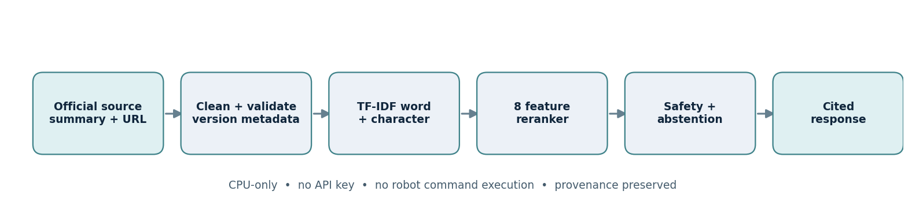
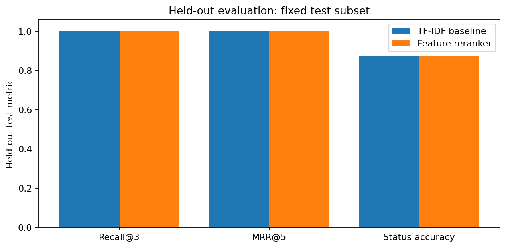

# RoboGuide AI

**Evidence-first, version-aware robotics troubleshooting · SunFounder PiDog · CPU-first · No API key**

> **Status:** working, reproducible educational research prototype (not manufacturer-endorsed; not a deployed support product). Project for ITAI 2377, Houston City College, group **Tung Tung Tung Sahar**. All metrics below come from the included, reproducible benchmark; limitations are explicit.



RoboGuide maps vague user questions such as *"My dog wobbles when it stands"* to linked manufacturer guidance about servo alignment, calibration, power and firmware/version differences. It couples **word + character TF-IDF retrieval** with **eight interpretable domain features**, **hard version-compatibility filtering**, conservative safety/abstention logic and cited extractive responses. It never controls a physical robot, executes shell commands, requires a GPU or makes paid API calls.

## Evaluated results

| Metric | TF-IDF baseline (dev) | Hybrid (dev) | TF-IDF baseline (fixed test) | Hybrid (fixed test) |
|---|---:|---:|---:|---:|
| Recall@3 | 0.871 | **0.871** | 1.000 | **1.000** |
| MRR@5 | 0.774 | **0.839** | 1.000 | **1.000** |
| Status accuracy | 0.943 | **0.971** | 0.875 | **0.875** |
| Intent accuracy | 0.857 | **0.857** | 0.750 | **0.750** |

The development MRR increases by **0.0645**; there is **no held-out retrieval gain on the eight-query test slice**. The corpus includes **24 manually curated summaries** of official manufacturer pages and the evaluation has **43 hand-authored questions** (35 development, 8 test). These tests are *in-manual* and the test slice was inspected during prototype development. This is **not** independently collected real-user evidence, nor proof of generalization. The originally proposed 80–150 full source files, 150–250 labeled queries, MiniLM/FAISS benchmark and human citation scoring are **future objectives**.



## Architecture and innovations

The retriever generates these eight named candidate features: `word_similarity`, `char_similarity`, `entity_overlap`, `title_overlap`, `api_match`, `fingerprint_match`, `version_compatibility`, `source_authority`. These are not merely prose design ideas; they are implemented in `roboguide/core.py`, evaluated with query-grouped permutation tests and ranking-feature ablations.

- **Error fingerprints** remove unstable traceback paths/line references while retaining exception type and stable message. The same `ModuleNotFoundError` at different local paths normalizes to one signature. It is tested, but its measured importance is zero in this pilot because the corpus contains no matching traceback examples.
- **Version-aware safety:** Standard/V1 zeroing instructions cannot appear in V2-only results and vice versa. For example, V2 includes an onboard zero button whereas Standard/V1 uses a script (verify details against current official documentation).
- **Source-traceable responses:** every answer carries titles, source links and `[S1]`-style evidence IDs; runtime only extracts from its curated knowledge base.
- **Selective response:** unrelated, hazardous and low-evidence cases are declined or escalated. The displayed evidence-strength value is **heuristic**, not calibrated correctness probability.
- **Offline resilience:** works on CPU with scikit-learn and a small local JSON corpus; no generator is needed.
- **Data engineering demonstration:** source manifests and optional official HTML ingestion, clear dirty-fixture preprocessing comparison, unique IDs, provenance validation, development-only numeric scaling/one-hot encoding and programmatic plots.

## Run locally (Python 3.10+)

```bash
python -m pip install -e '.[test,ui,online]'
python -m pytest -q
python -m roboguide.evaluation
python -m roboguide "My V2 zero button works but Python control fails" --version v2
python -m roboguide.app
```

The Gradio app starts a browser-based interface. No robot, API token or Raspberry Pi is required. Launch only on a trusted local host and do **not** expose it as an authenticated hardware support endpoint without a separate security review.

## Google Colab notebook

[**Open RoboGuide Colab notebook**](notebooks/RoboGuide_Colab.ipynb) — complete notebook with executed output cells, preprocessing demonstrations, feature encoding, error fingerprints, assistant examples, evaluation and figures. On GitHub in the portfolio, use **Open in Colab** to clone the project and run it, or upload the complete project archive from the ChatGPT delivery and open the notebook from the root folder. Optional Colab install: `%pip install -q -e '.[test,ui,online]'`.

## Curated data vs official live source collection

`data/curated_official_summaries.json` is **not** a scraped corpus. Each record paraphrases a specific official manufacturer procedure and has an auditable source URL, title, version and explicit `source_type=official_curated_summary`. See `data/make_corpus.py` for how it was generated.

An **optional** official source ingestion command is available in a connected environment:

```bash
python -m roboguide.ingest --online
```

It follows an HTTPS domain/path allowlist, records source SHA-256 and timestamps, strips navigation HTML, preserves basic code blocks, removes exact duplicates and writes `data/snapshots/online_unreviewed_chunks.json`. These unreviewed chunks are **not** automatically promoted into the evaluated corpus or presented as fully correct for all hardware versions. Manual review and source-licensing checks must come first.

## Preprocessing and feature engineering

| Requirement | Code and evidence |
|---|---|
| Missing value handling | `roboguide/evaluation.py::quality` restores intentionally corrupted known-source fields from the canonical records only |
| Duplicates | deterministic ID deduplication in the dirty-fixture exercise and SHA-256 dedupe in live collector |
| Text normalization | Unicode NFKC, whitespace cleanup, preserve code-method spelling |
| Numeric feature standardization | `roboguide/preprocessing.py::encode_features` with development-only `StandardScaler` |
| Category encoding | development-only `OneHotEncoder(handle_unknown='ignore')` for subsystem and hardware version |
| Data distributions | figures `01_quality_before_after`, `04_corpus_lengths` |
| Feature importance | `03_feature_importance`; grouped candidate held-out permutation average precision, and `development_mrr_drop_by_ablation` |
| Baseline contrast | `02_baseline_vs_hybrid`, metrics.json, per-question CSV |
| Eight actual interactions | `results/interactions.json` |

**The intentionally corrupted data fixture is a controlled educational test and not evidence that SunFounder's original manual contains missing/duplicated data.** For a real full-corpus ingestion claim, run the networked collector and have a human audit version-specific text and code fidelity.

## Technical report and artifacts

- [**Final academic report (14-page PDF)**](FN_JoseTuozzo_TungTungTungSahar_ITAI2377.pdf)
- [Executed Colab notebook](notebooks/RoboGuide_Colab.ipynb)
- [Baseline/hybrid metrics](results/metrics.json)
- [Per-question errors and cases](results/per_question_results.csv)
- [Eight assistant conversations with linked references](results/interactions.json)
- [Official-source summaries](data/curated_official_summaries.json)
- [Frozen manually authored benchmark](data/benchmark.json)
- [Group contribution verification template](docs/CONTRIBUTIONS_TEMPLATE.md)

## Structure

```text
RoboGuide-AI/
├── roboguide/
│   ├── core.py             # search, eight features, hard version filters, citations
│   ├── preprocessing.py    # numeric/categorical feature transformations
│   ├── evaluation.py       # baseline, metrics, ablation, importance, figures
│   ├── ingest.py           # opt-in online official-domain source snapshot
│   ├── app.py              # Gradio UI
│   └── __main__.py         # CLI
├── data/                    # curated official summaries, source builder, 43-query benchmark
├── tests/                   # 19 passing pytest tests
├── notebooks/               # executed Colab-format notebook
├── docs/figures/             # architecture and observed metrics/quality plots
├── results/                  # reproducible JSON, CSV and example conversations
├── docs/CONTRIBUTIONS_TEMPLATE.md
├── FN_JoseTuozzo_TungTungTungSahar_ITAI2377.pdf
└── pyproject.toml
```

## Important constraints / scientific and safety ethics

- The assistant makes no live physical measurements and cannot confirm whether a specific battery, board or servo is safe. **Power down when changing camera wiring or addressing a potential electrical hazard and consult the current official instructions.**
- Official source descriptions are paraphrased and linked; SunFounder remains the primary authority. Version-specific procedures may change.
- Retrieval strength is not factual truth, model probability or electrical safety certification.
- No results are claimed for a neural embedding model, FAISS or a generative instruction model because none were evaluated here.
- No measured human task-resolution rate, citation correctness percentage or generalization to unseen users is asserted.
- The original team plan allocated José Tuozzo integration/evaluation, Kim Nguyen sourcing/quality and Huu Huynh retrieval/UI/testing. **These responsibilities are not evidence that all three implemented the current prototype or authored any particular section.** See the unsigned contribution template; team verification is required before academic submission.

## References

- [SunFounder PiDog documentation](https://docs.sunfounder.com/projects/pidog/en/latest/)
- [SunFounder FAQ](https://docs.sunfounder.com/projects/pidog/en/latest/faq.html)
- [Calibrating PiDog](https://docs.sunfounder.com/projects/pidog/en/latest/python/py_0_calibrate.html)
- [Preset actions API](https://docs.sunfounder.com/projects/pidog/en/latest/python/py_b6_preset_action.html)
- [Robot HAT documentation](https://docs.sunfounder.com/projects/robot-hat/en/latest/)
- [SunFounder/pidog repository](https://github.com/sunfounder/pidog)

**License note:** All project-written glue code is offered for educational inspection; no upstream SunFounder code or diagrams are relicensed. Review third-party terms before incorporating full source snapshots.
